¿Se puede, en un fin de semana, implementar desde cero la gestión automatizada de una infraestructura completa: persistencia, ingress, separación de privado y público, despliegues versionados, promoción de desarrollo a producción, repositorios de código, build e imágenes automáticos, definición de enjambres…?

Un experimento completo con DeepSeek 4.1 Flash 1017 para probar el agent coding sobre Rust.

## Entregable final

A partir de un único servidor «pelado», capacidad para:

1. definir un proyecto o aplicación (SaaS, web app, investigación…);
2. build, despliegue y versionado totalmente automáticos y desatendidos;
3. cero configuración y cero código: todo se genera solo;
4. empujar tareas agénticas al ciclo de desarrollo a partir de una única entrada (típicamente un prompt).

## Qué se hizo (a ratos)

El desarrollo consistía básicamente en:

1. Se generaba una especificación completa (`01_spec.adoc`) en vibe, revisada hasta alcanzar suficiente detalle.
2. Una vez lista, el agente generaba un `02_plan.adoc` que se revisaba en un breve vibe.
3. Se revisaba algún detalle y se entregaban los cambios en lotes (mera enumeración: «eh, cambia: A, B, C»).

Eso, para cada pieza principal: la definición de una infraestructura básica reproducible (a partir de un servidor, levantar la base: nginx, Docker, PostgreSQL, Forgejo…), `swarm.runner`, `swarm.apps` y `swarm.agents`.

Y bueno, este ha sido el resultado.

## Arquitectura

Todo el sistema se apoya en un único bastión de Hetzner. Sobre él corren Docker, nginx, PostgreSQL, Forgejo y los propios servicios de swarm. nginx publica en el puerto 444 las aplicaciones privadas, protegidas con HTTPS, certificado de cliente y autenticación básica. PostgreSQL actúa como base de datos común. Los trabajadores de ejecución, en cambio, son máquinas efímeras que se crean y se destruyen según la carga.

<figure style="margin: 0 0 2em 0;">
  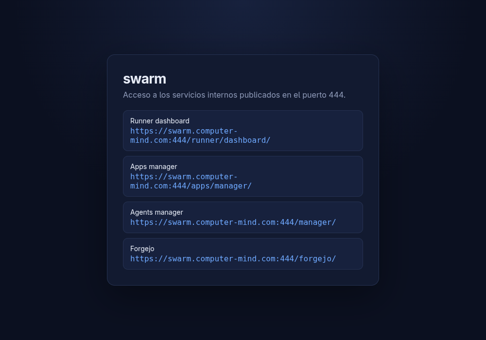
  <figcaption style="text-align: center; color: #888; font-size: 0.9em; margin-top: 0.5em;">Índice de acceso a los servicios internos</figcaption>
</figure>

### Forgejo

El código vive en Forgejo, servido desde el mismo bastión. La organización `swarm` agrupa los repositorios de los proyectos y de la propia infraestructura.

<figure style="margin: 0 0 2em 0;">
  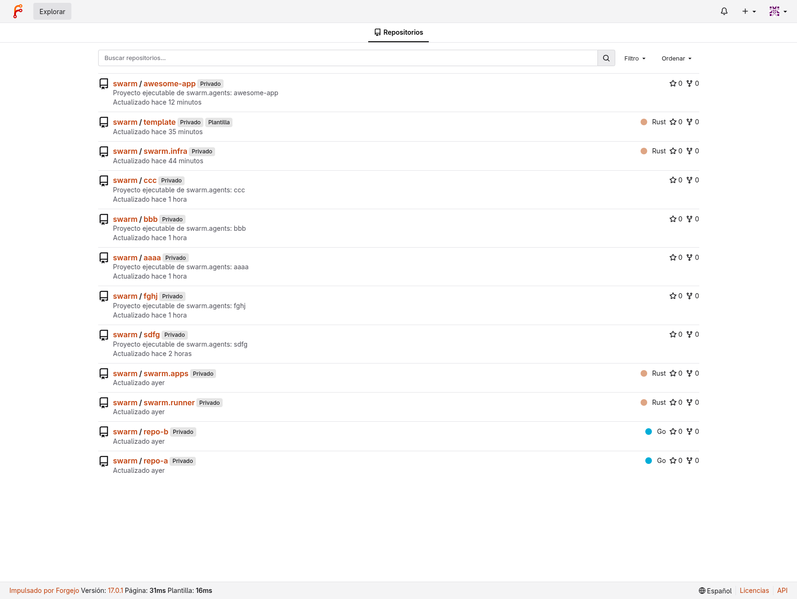
  <figcaption style="text-align: center; color: #888; font-size: 0.9em; margin-top: 0.5em;">Listado de repositorios</figcaption>
</figure>

<figure style="margin: 0 0 2em 0;">
  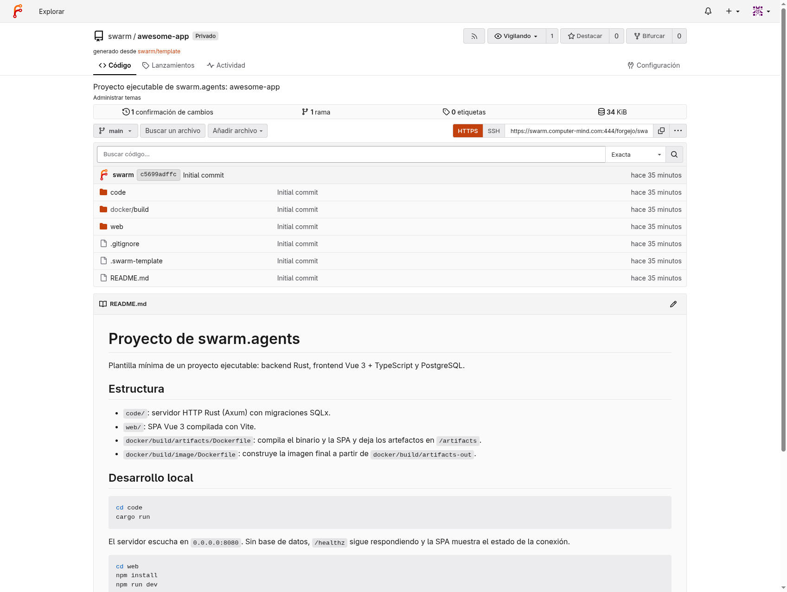
  <figcaption style="text-align: center; color: #888; font-size: 0.9em; margin-top: 0.5em;">Página del proyecto <code>awesome-app</code>, creado automáticamente por <code>swarm.agents</code></figcaption>
</figure>

## swarm.runner

`swarm.runner` es el punto de entrada de las tareas. Recibe trabajo, decide cuándo y dónde ejecutarlo y procura reutilizar la capacidad disponible. Hetzner cobra por horas naturales, así que conviene encender una máquina al principio de la hora y no apagarla hasta el final, encolando en ella las tareas que quepan antes de levantar otra.

<figure style="margin: 0 0 2em 0;">
  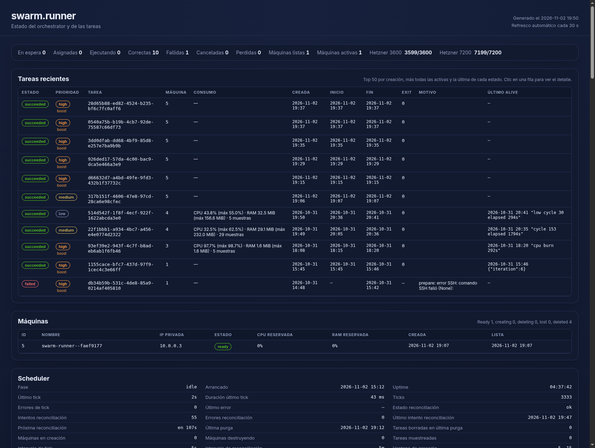
  <figcaption style="text-align: center; color: #888; font-size: 0.9em; margin-top: 0.5em;">Panel del orquestador</figcaption>
</figure>

<figure style="margin: 0 0 2em 0;">
  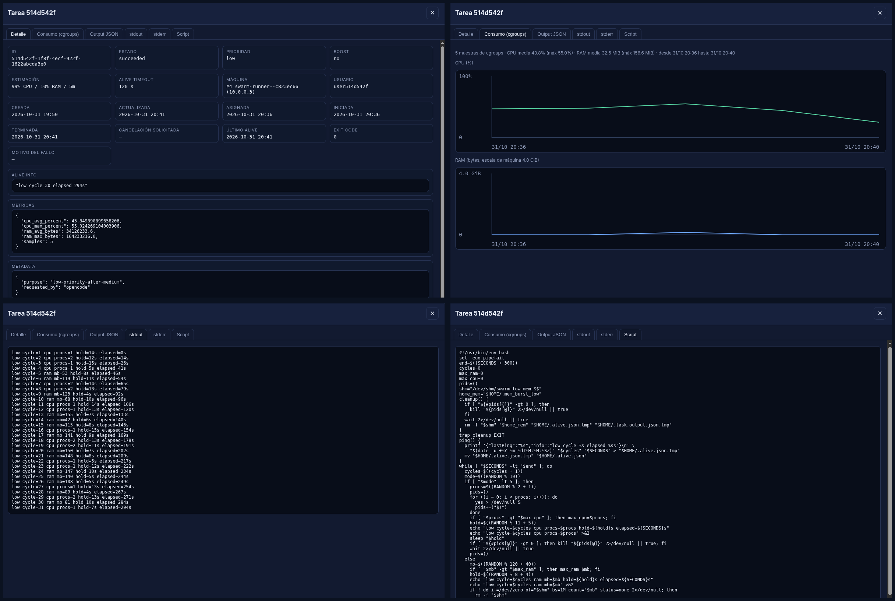
  <figcaption style="text-align: center; color: #888; font-size: 0.9em; margin-top: 0.5em;">Detalle de una tarea: detalle, consumo, stdout y script</figcaption>
</figure>

<figure style="margin: 0 0 2em 0;">
  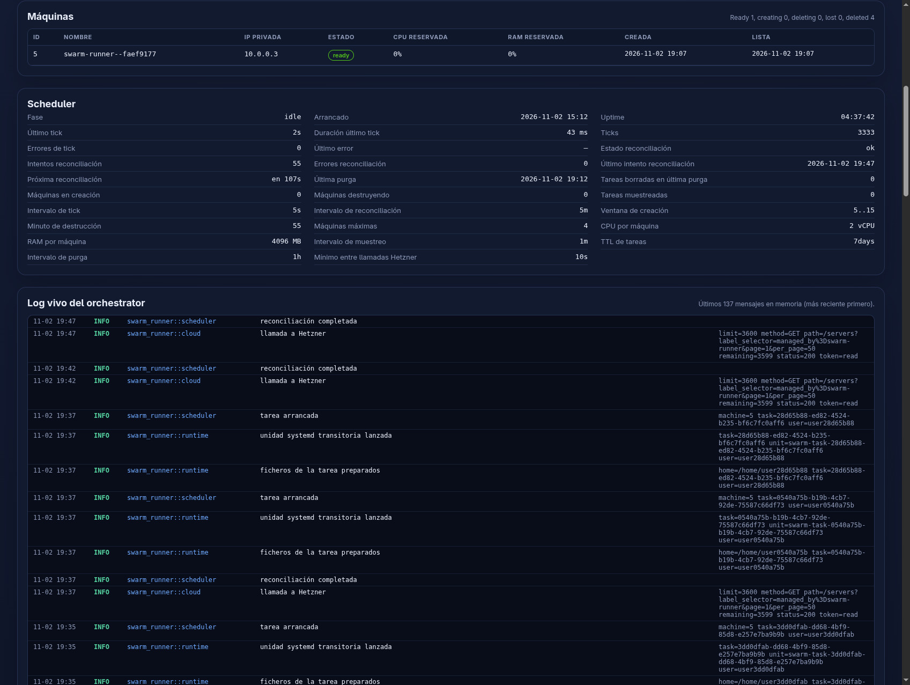
  <figcaption style="text-align: center; color: #888; font-size: 0.9em; margin-top: 0.5em;">Máquinas, scheduler y log del orquestador</figcaption>
</figure>

## swarm.apps

`swarm.apps` despliega aplicaciones de forma declarativa y automática a partir de su repositorio. Construye la imagen, publica puertos, genera el ingress de nginx y provisiona la base de datos de cada entorno. También gestiona todo el ciclo de despliegue y versionado. Mantiene el entorno de DES y permite promocionar una versión a PRO. Permite, además, mapear servicios entre aplicaciones, registrar URLs y otras tareas de plomería.

<figure style="margin: 0 0 2em 0;">
  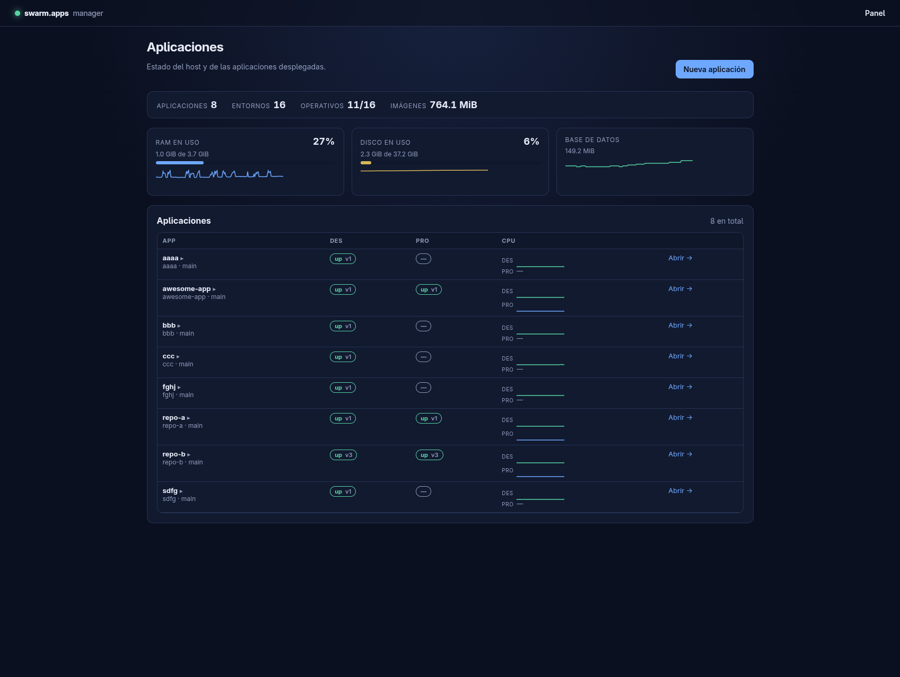
  <figcaption style="text-align: center; color: #888; font-size: 0.9em; margin-top: 0.5em;">Listado de aplicaciones</figcaption>
</figure>

<figure style="margin: 0 0 2em 0;">
  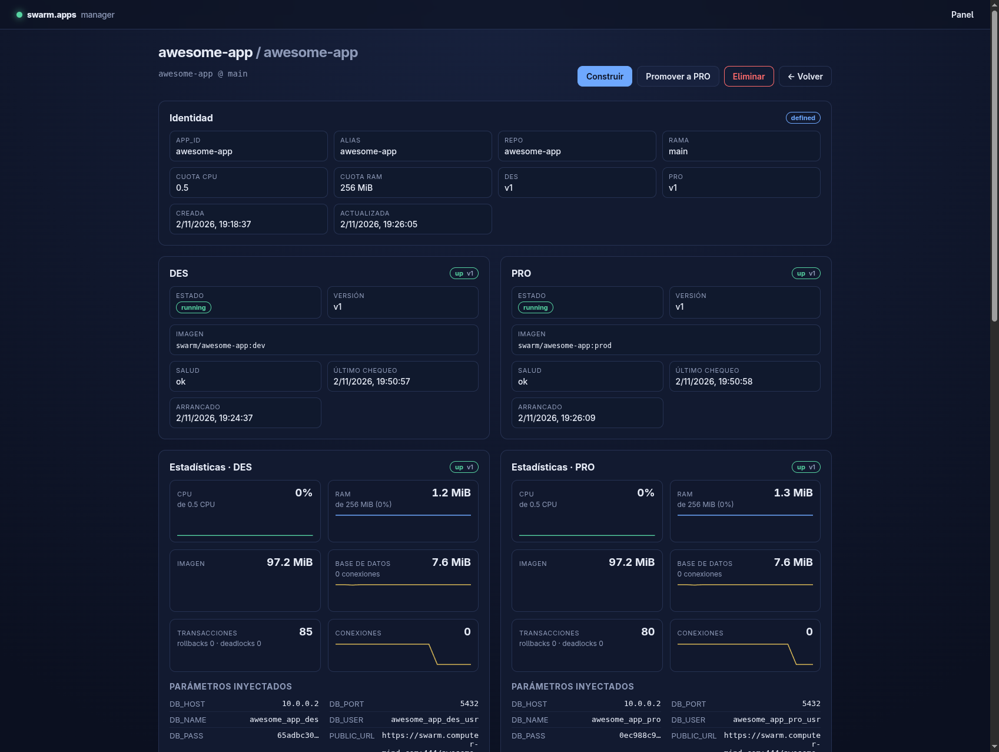
  <figcaption style="text-align: center; color: #888; font-size: 0.9em; margin-top: 0.5em;">Detalle de <code>awesome-app</code></figcaption>
</figure>

<figure style="margin: 0 0 2em 0;">
  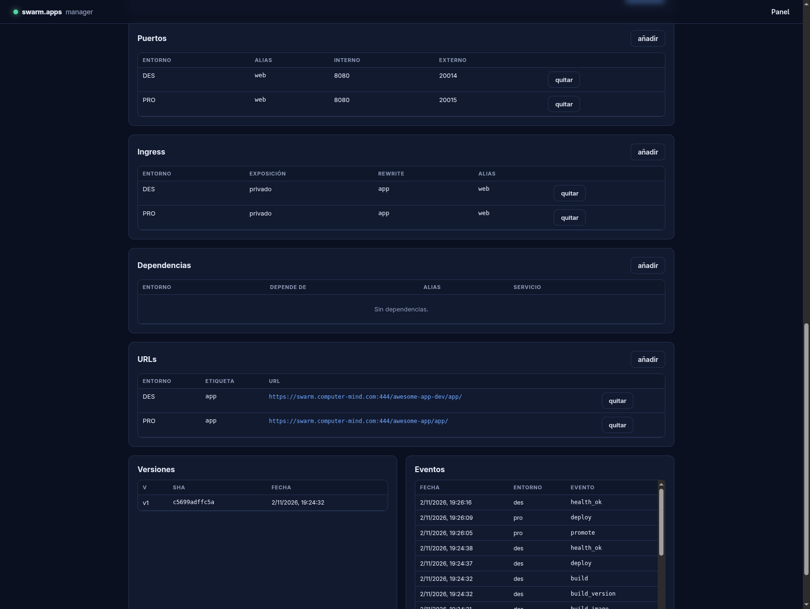
  <figcaption style="text-align: center; color: #888; font-size: 0.9em; margin-top: 0.5em;">Puertos, ingress, URLs y versiones</figcaption>
</figure>

## swarm.agents

`swarm.agents` es el intérprete de grafos de agentes. Un proyecto agrupa agentes y cada agente es un grafo que puede reutilizar otros agentes y delegar el trabajo largo en `swarm.runner`. Cada proyecto define así sus propios grafos, runners y condiciones, y recibe tareas desde fuera que serán ejecutadas.

<figure style="margin: 0 0 2em 0;">
  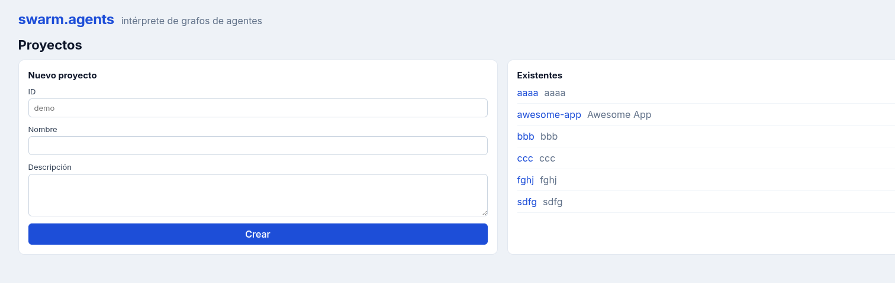
  <figcaption style="text-align: center; color: #888; font-size: 0.9em; margin-top: 0.5em;">Proyectos de agentes</figcaption>
</figure>

<figure style="margin: 0 0 2em 0;">
  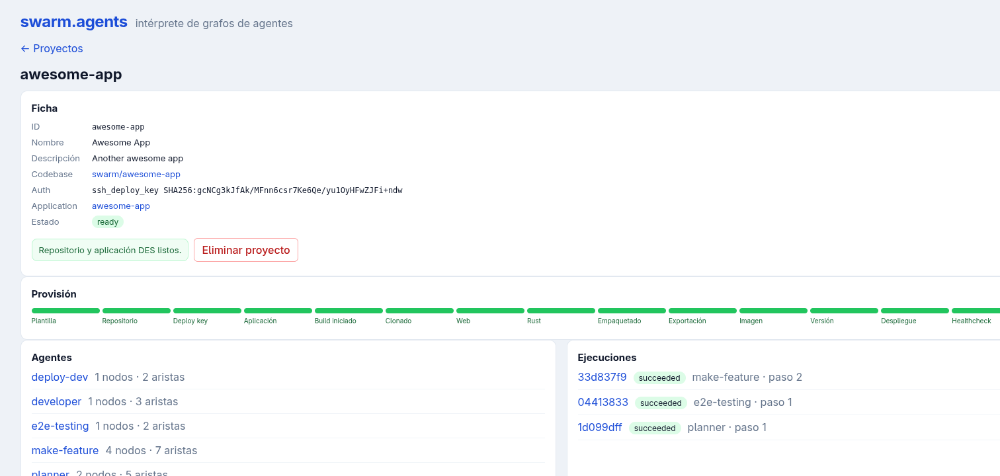
  <figcaption style="text-align: center; color: #888; font-size: 0.9em; margin-top: 0.5em;">Proyecto <code>awesome-app</code></figcaption>
</figure>

<figure style="margin: 0 0 2em 0;">
  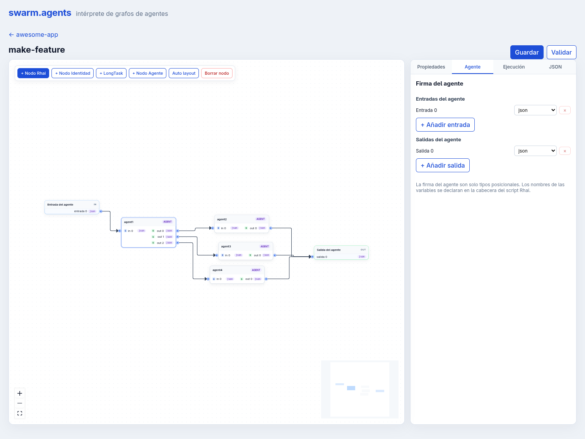
  <figcaption style="text-align: center; color: #888; font-size: 0.9em; margin-top: 0.5em;">Agente <code>make-feature</code>: vista general</figcaption>
</figure>

<figure style="margin: 0 0 2em 0;">
  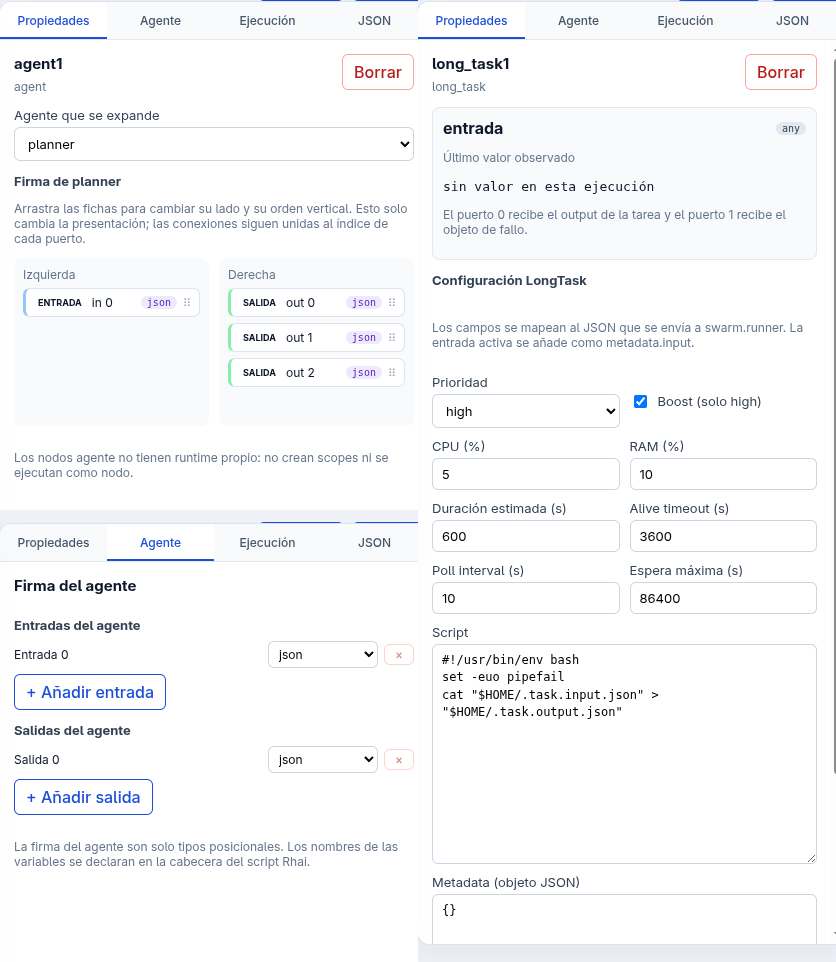
  <figcaption style="text-align: center; color: #888; font-size: 0.9em; margin-top: 0.5em;">Agente <code>make-feature</code>: propiedades y firma; a la derecha, propiedades de <code>planner</code></figcaption>
</figure>

<figure style="margin: 0 0 2em 0;">
  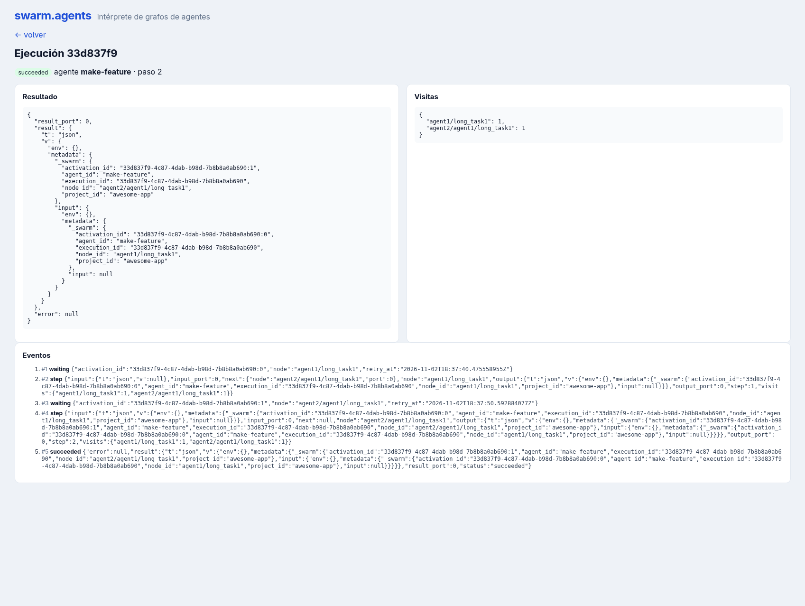
  <figcaption style="text-align: center; color: #888; font-size: 0.9em; margin-top: 0.5em;">Ejecución <code>33d837f9</code>: resultado, visitas y eventos</figcaption>
</figure>

<figure style="margin: 0 0 2em 0;">
  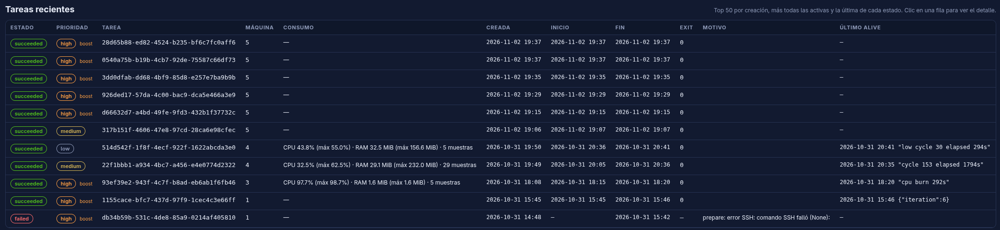
  <figcaption style="text-align: center; color: #888; font-size: 0.9em; margin-top: 0.5em;">Cada ejecución genera la ejecución de tareas que necesite</figcaption>
</figure>

La tarea del runner conserva la referencia al proyecto, al agente, a la ejecución y al nodo que la originaron. Esa trazabilidad es la que permite saltar de una ejecución a la tarea concreta que la materializó y volver, sin perder el hilo, al punto del grafo donde todo empezó.
